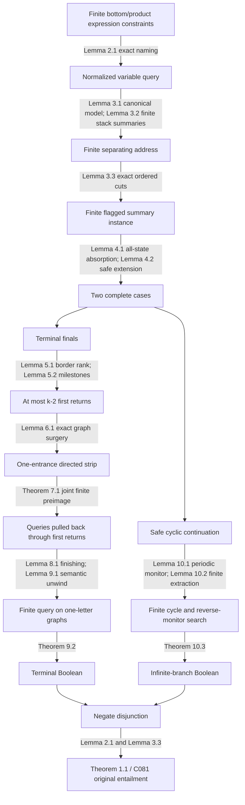

# Proof dependency map

This is the mathematical route used by C081 at source checkpoint
`c946d86b9e65da2877e0df42c710abbdcb5a4037`. Numbered results refer to the
[ordinary manuscript](manuscript.md); exact declarations and source identities
are in the [Lean map](lean-map.md).

The difficult dependency is Theorem 7.1: semantic coverage and reconstruction of an
entire conjunction using a common generator. Bounding each path separately
without preserving the common strip would not prove it.

The explicit numerical `ClosureFor` bound, old C080 `F(k)`, C030 converse,
Q004 computability corollary and historical shortening conjectures are **not
premises** of this route. The checked `RankQuerySemanticUnwind` avoids the
stronger quantitative hypothesis. Finite native tests, CI status and agreement
between reviewers are evidence records, not edges replacing a mathematical proof.

The [generated import closure](imports.md) lists the actual source modules
reachable from `Subtail.EntailmentDecision`. It is a different object: imports
may carry unused theorems and fixture definitions. The full default `Subtail`
aggregator also retains exploratory results. Use declaration-level dependency
and axiom audits to identify proof dependencies; do not infer them merely from
an import edge.

## Reading paths

For the theorem: manuscript Sections 1–4, then 11. For the central construction:
Sections 5–9 in order. For the other branch: Section 10. For independent checking:
start with the literal witness predicate (3.4), the finite query grammar in 7.1,
and both directions in 7.7–7.8 before comparing the declaration map.

The chronological `notes/` and approach histories remain discovery records.
They contain false strengthenings, conditional claims and older open gaps.
Their preservation does not make them assumptions or conclusions of C081.
